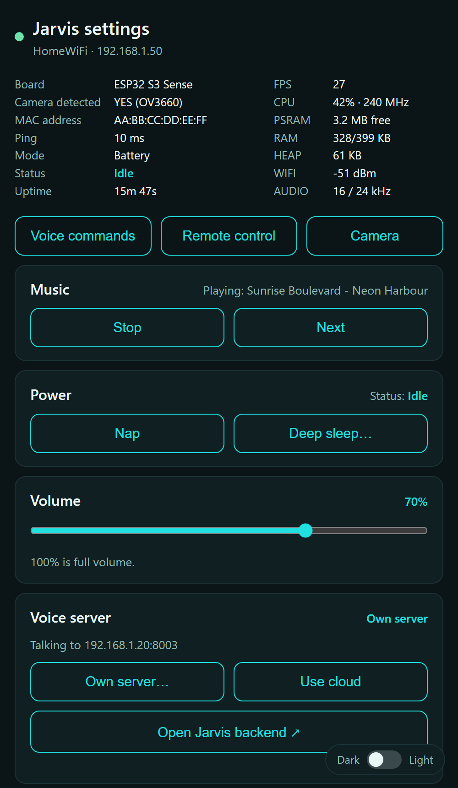
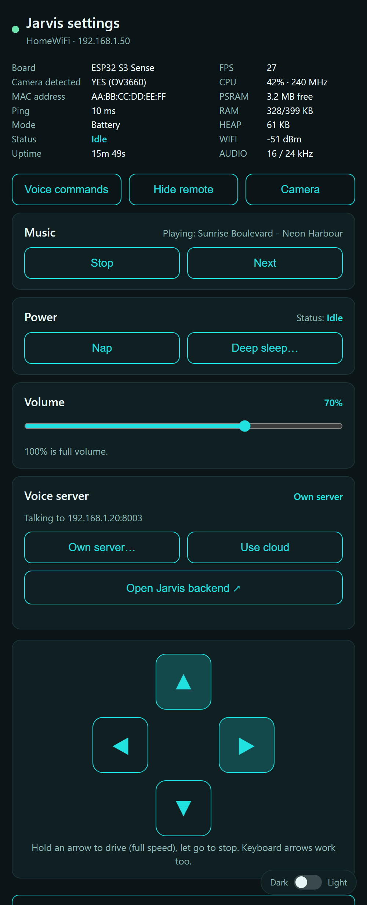
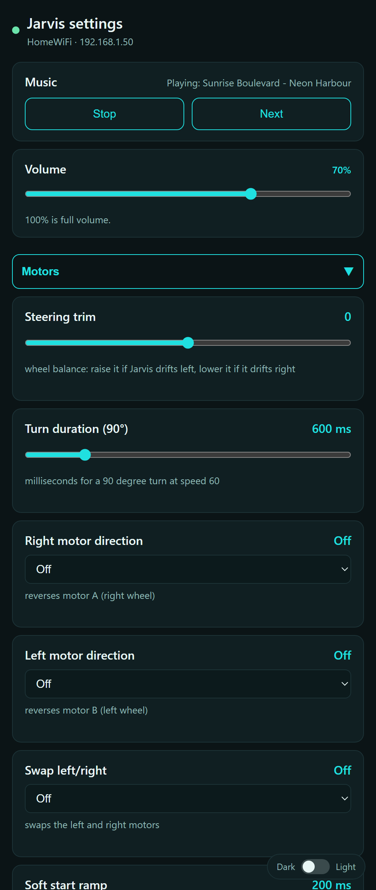
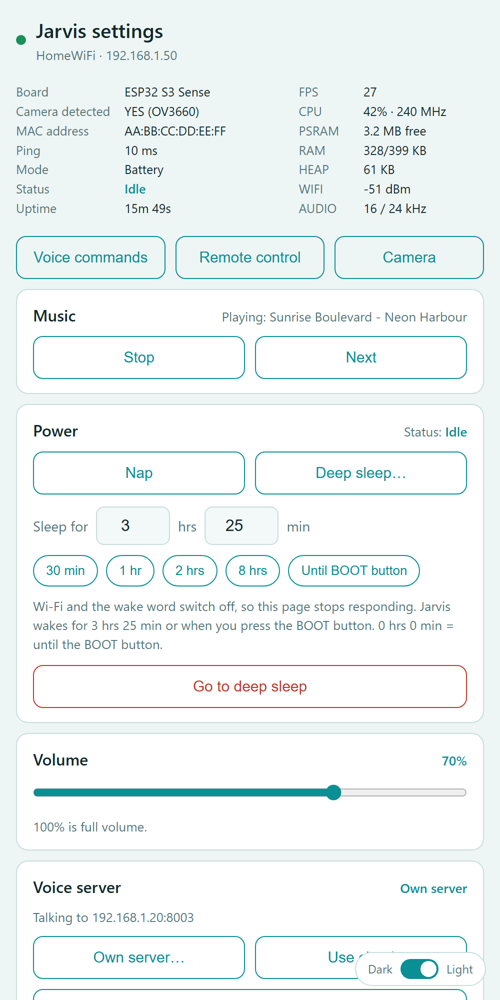
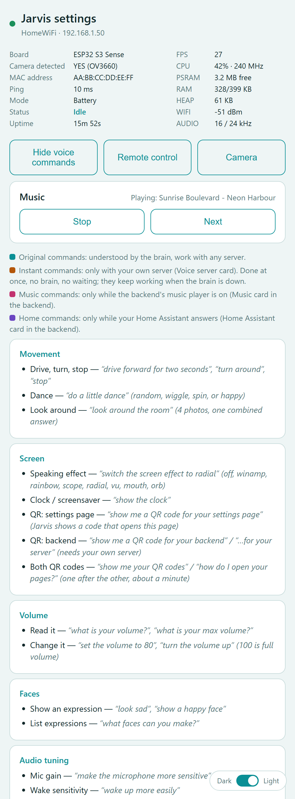
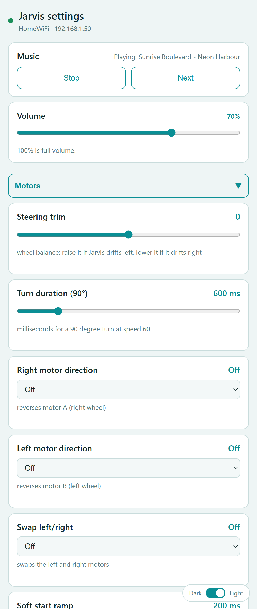
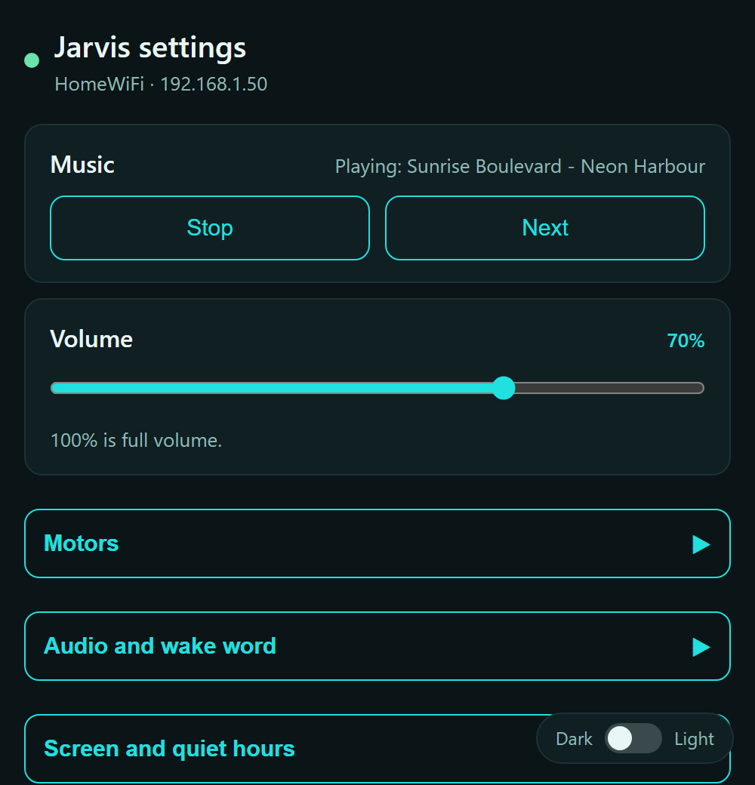

# Jarvis landing page

The settings and remote-control web page of the **Jarvis robot**: a voice robot built on the
[xiaozhi-esp32](https://github.com/78/xiaozhi-esp32) firmware (ESP32-S3, board `wall-e-xiao`). The robot
serves this page itself at `http://<robot-ip>/`; open it on a phone or PC on the same WiFi.

It is one self-contained file, [`index.html`](index.html) (plain HTML, CSS and JavaScript, no build step, no
libraries, no internet needed), and it talks to the robot through a small JSON API documented in
[`docs/API.md`](docs/API.md).

| Info, power, nap and deep sleep | Remote control (hold the arrows) | Settings |
|---|---|---|
|  |  |  |
|  |  |  |

With an own backend (Voice server card) the page also shows the backend's **Music** card (title, Stop, Next) while its music player is on, and the music, radio and
Home Assistant command lists (each in its own colour):

| Music card |
|---|
|  |

(Screenshots come from the fake robot in `mock/`, with made-up data. The page follows the phone's dark or
light setting; the slider at the bottom right switches it.)

## What it does

- **Device info**: board, camera (detected + sensor), MAC, live ping, mode (console / battery), status,
  uptime, FPS, CPU load, PSRAM, RAM, heap, WiFi signal, audio rate. Polled every second, ping 3 times a second.
- **Power**: Nap / Wake up, and Deep sleep for any hours + minutes (or until the BOOT button), with a confirmation.
- **Remote control**: four arrows, hold to drive at full speed; two together turn in an arc. The page
  re-sends the command every 150 ms and the robot stops 500 ms after the last one, so a lost connection stops it.
- **Settings** built from what the robot reports (sliders, switches, dropdowns, time pickers, text),
  grouped into Motors, Audio and wake word, Screen and quiet hours, Weather, Visualizer, System. Changes
  save the moment you release a control.
- **Voice commands**: the list of things you can say to the robot.
- **Dark / light theme** slider, remembered in the browser.

## Try it without a robot

Needs only Python 3:

```
python mock/mock_robot.py          # then open http://127.0.0.1:8080/
```

The fake robot serves `index.html` and every API endpoint, keeps your setting changes in memory and
reacts to nap and wake. To edit the page, change `index.html` and reload.

`python mock/screenshots.py` regenerates the pictures in `docs/screenshots` (needs Chrome or Edge).

## Using it in the firmware

The firmware embeds `web/index.html` into the binary at build time. In the
[firmware repository](https://github.com/txrx007-hub/xiaozhi-esp32/tree/wall-e) this repository is a git
submodule at `main/boards/wall-e-xiao/web`, so:

```
git clone --recurse-submodules -b wall-e https://github.com/txrx007-hub/xiaozhi-esp32.git
```

builds the whole thing. To work on the page alone, clone just this repository and use the fake robot above;
to put a changed page into the firmware, commit it here and update the submodule pointer there (or simply
copy `index.html` over the file in `web/`). The firmware only looks at `web/*.html`, so the other files
here (docs, mock) are never flashed.

## Related

- **Firmware**: [txrx007-hub/xiaozhi-esp32](https://github.com/txrx007-hub/xiaozhi-esp32/tree/wall-e) (branch `wall-e`)
- **Android app** with the same screens: [txrx007-hub/jarvis-robot-android](https://github.com/txrx007-hub/jarvis-robot-android)

## License

MIT, see [LICENSE](LICENSE).
